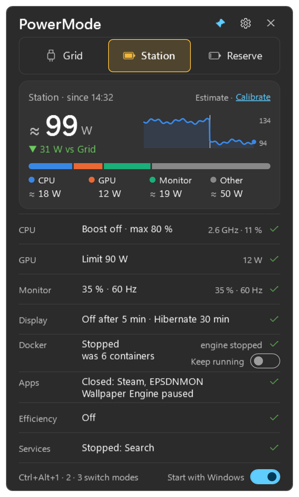
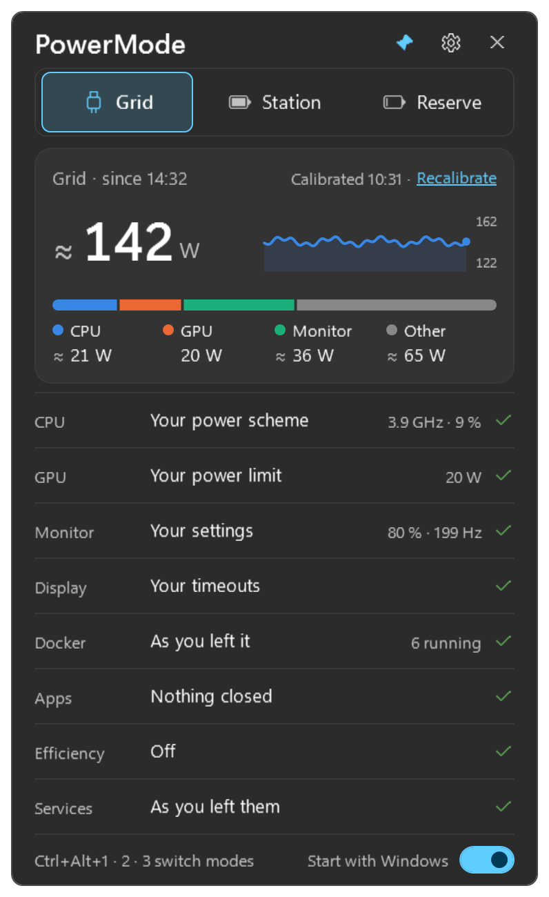
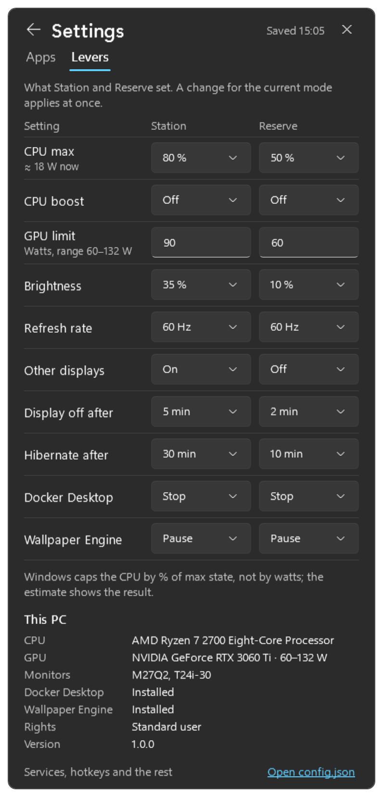
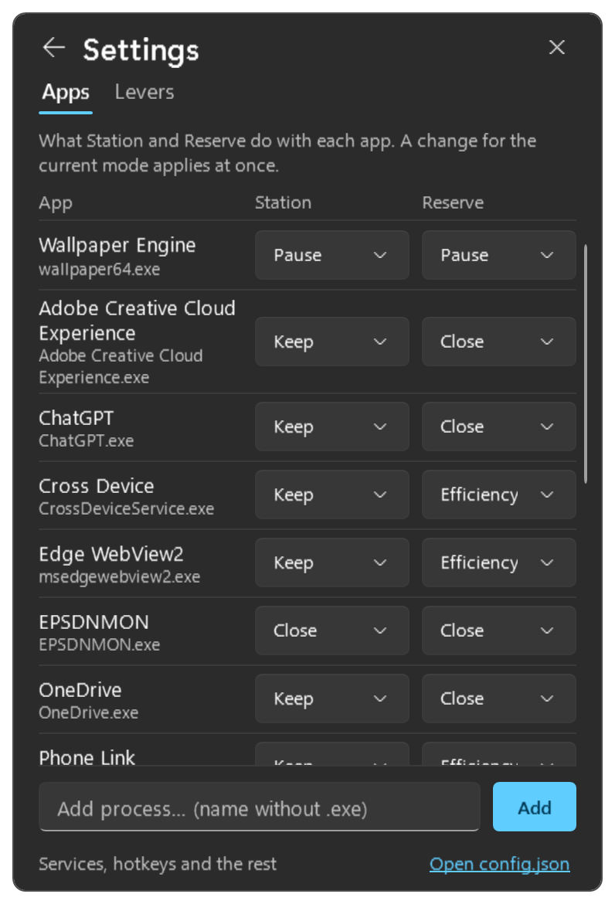

# PowerMode

**PowerMode** is a small Windows 11 tray app for desktop PCs that run from a portable power station or a UPS
during blackouts. One click (or a hotkey) switches the PC between three power modes: **Grid** (everything as you
left it), **Station** (comfortable savings) and **Reserve** (maximum savings). It lowers the CPU and GPU power
limits, dims the monitors, drops the refresh rate, turns secondary displays off, pauses Wallpaper Engine, stops
Docker Desktop, closes or throttles background apps and stops heavy services — and puts every one of them back
exactly as it was when you return to Grid. A card at the top shows how much the PC draws right now (an estimate
you calibrate once against the station's own display) and how much the mode saves.



## Features

- **Three modes, one click**: flyout from the tray icon, `Ctrl+Alt+1/2/3`, the tray menu, or `PowerMode.exe
  --mode station` from a script.
- **Exact restore**: leaving Grid records a baseline (power scheme, brightness, display modes and layout, GPU
  limit, running apps, containers, services); Grid puts it back lever by lever and retries what failed.
- **Power estimate**: `≈ 142 W` with `▼ 61 W vs Grid`, a 10-minute line and the parts CPU, GPU, monitors and
  the rest, calibrated against your power station's display.
- **Settings in the flyout**: what each mode does with every app (keep, efficiency mode, close) and every lever
  (CPU %, GPU watts, brightness, refresh rate, other displays, timeouts, Docker, Wallpaper Engine).
- **Several monitors**: brightness and refresh rate on each, secondary displays off in Reserve.
- **Safe at shutdown**: shutting Windows down in Station or Reserve restores Grid's scheme, displays and GPU limit
  first, and the next start begins without limits.
- **Adapts to the PC**: no NVIDIA GPU, no Docker or no Wallpaper Engine simply skips those levers; a laptop
  panel is dimmed through Windows.
- **Always visible**: the tray icon is coloured by mode and moved onto the taskbar on first start; the flyout can
  stay pinned open.

| Grid | Settings: levers | Settings: apps |
|---|---|---|
|  |  |  |

Tray icons (dark and light taskbar): 

## Download and install

1. Download `PowerMode.exe` from the [latest release](../../releases/latest). It is one self-contained file;
   no .NET install is needed.
2. Put it anywhere (for example `%LOCALAPPDATA%\Programs\PowerMode\`) and double-click it. The icon appears in
   the notification area.
3. Right-click the icon: **Create desktop shortcut** and **Start with Windows** (asks for administrator rights
   once, so the GPU limit and services work at every start without a prompt).

To update, quit PowerMode from the tray menu (**Quit (keep mode)**), replace the exe and start it again.
Building from source? `install.ps1` copies the built exe to `%LOCALAPPDATA%\Programs\PowerMode`, creates the
desktop shortcut and points the autostart task at it.

## The three modes

| Lever | Grid | Station | Reserve |
|---|---|---|---|
| Power scheme | your scheme from before | **PowerMode Station**: boost off, CPU max 80 %, display off 5 min, hibernate 30 min | **PowerMode Reserve**: boost off, CPU max 50 %, display off 2 min, hibernate 10 min |
| Monitor brightness (DDC/CI; laptop panel through Windows) | restored | 35 % | 10 % |
| Refresh rate | restored | 60 Hz | 60 Hz |
| Other displays | restored | on | off |
| GPU power limit (NVIDIA, **admin**) | restored | 90 W | 60 W (within the card's range) |
| Wallpaper Engine | playing again if it was | paused | paused |
| Docker Desktop | started again with its containers | stopped (or **Keep running**) | stopped |
| Apps | relaunched if PowerMode closed them | a short close list | a longer close list |
| Efficiency mode (EcoQoS) | cleared | — | chat apps, Edge WebView2, Phone Link |
| Windows services (**admin**) | started again if they ran | Windows Search | Search, SysMain, telemetry, print spooler, database services |

Every list and value is editable on the settings pages or in `config.json`. PowerMode only ever writes its own two
power schemes; your schemes are only re-activated. An app you quit yourself is never relaunched.

## How the power estimate works

A desktop PC cannot measure its own total draw without a kernel driver, so PowerMode measures what it can and
estimates the rest, every 2 seconds:

- **GPU**: board power from the NVIDIA driver (measured, shown without `≈`).
- **CPU**: from utilisation and the effective clock: `cpuIdleW + cpuSpanW · utilisation · (GHz / cpuBaseGhz)^2`.
- **Monitors**: from each monitor's brightness and refresh rate.
- **Other**: board, RAM, drives, fans, USB, the power supply's losses and your calibration.

Total = `(CPU + GPU + other) / psuEfficiency + monitors + calibration`. On the first start the CPU part is tuned
from the CPU's name and clock.

**Calibrate once**: click **Calibrate** on the card and type what your power station's display shows right now
(do it while the PC is idle, not during a switch). The difference becomes an offset added to every estimate;
**Recalibrate** replaces it, **Reset** removes it. The station's display stays the reference: the estimate is
there to show the trend and the saving.

## Configuration

Settings live in `%LOCALAPPDATA%\PowerMode\config.json`, created with the defaults on the first start and reloaded
whenever it is saved (an invalid file is ignored and the last good one kept). The settings pages write the same
file and change only the keys you touch. Every key is optional; lists replace the default list; `null` for a
number means "leave this lever alone in this mode"; comments and trailing commas are allowed.

| Key | Default | Meaning |
|---|---|---|
| `hotkeys.grid` / `.station` / `.reserve` | `Ctrl+Alt+1` / `2` / `3` | Global hotkeys (`Ctrl`, `Alt`, `Shift`, `Win` + a key); empty = none |
| `flyout.anchor` / `flyout.margin` | `bottomRight` / `12` | Corner of the work area and the distance from its edges |
| `modes.<mode>.scheme.*` | see the table above | `boost`, `maxProcessorPercent`, `minProcessorPercent`, `displayOffSeconds`, `sleepSeconds`, `hibernateSeconds` of the PowerMode scheme |
| `modes.<mode>.brightnessPercent` | `35` / `10` | Monitor brightness 0–100 |
| `modes.<mode>.refreshRateHz` | `60` | Refresh rate; a display without it gets its lowest rate from 50 Hz |
| `modes.<mode>.gpuLimitWatts` | `90` / `60` | GPU power limit, clamped to the card's range |
| `modes.<mode>.secondaryDisplaysOff` | `false` / `true` | Turn every display but the primary off |
| `modes.<mode>.pauseWallpaperEngine` | `true` | Pause Wallpaper Engine |
| `modes.<mode>.stopDocker` | `true` | Stop Docker Desktop (Station's **Keep running** switch overrides it) |
| `modes.<mode>.closeApps` | per mode | Process names (without `.exe`) to close |
| `modes.<mode>.efficiencyApps` | per mode | Process names to put into efficiency mode |
| `modes.<mode>.stopServices` | per mode | Service names (not display names) to stop |
| `relaunchArguments` | `steam: -silent`, `OneDrive: /background` | Arguments used when relaunching an app |
| `docker.excludedContainers` / `docker.engineWaitSeconds` | `[]` / `120` | Containers Grid never starts again; how long Grid waits for the engine |
| `wallpaperEngine.path` | Steam's `wallpaper64.exe` | Used to send pause/play |
| `reapplyOnDisplayChange` | `true` | Correct brightness and refresh rate when Windows changes display settings (at most once a minute) |
| `gridOnShutdown` | `true` | At Windows shutdown or sign-out in Station/Reserve, restore Grid's scheme, displays, brightness and GPU limit first (within 5 s) |
| `startInGrid` | `true` | A start that finds Station or Reserve saved restores Grid instead of applying that mode again |
| `fallbackScheme` | the scheme active at the first start | Scheme Grid activates when the one active before is unknown |
| `power.cpuIdleW` / `power.cpuSpanW` | `15` / `45` | CPU estimate: idle watts and the span up to all cores busy |
| `power.cpuBaseGhz` / `power.cpuExponent` | `3.2` / `2.0` | Base clock and how steeply watts rise with the clock |
| `power.monitorBaseW` / `power.monitorPerPercentW` / `power.highRefreshExtraW` | `9` / `0.30` / `3` | Monitor estimate |
| `power.otherW` / `power.psuEfficiency` | `40` / `0.88` | The rest of the PC; power supply efficiency |

State (current mode, the baseline, the calibration) is kept in `%LOCALAPPDATA%\PowerMode\state.json`, written
atomically with a backup. Logs are in `%LOCALAPPDATA%\PowerMode\logs` (14 days); if that folder cannot be
written, lines go to `%TEMP%\PowerMode\powermode-fallback.log`. PowerMode writes a warning to the Windows
Application event log only if an event source named `PowerMode` already exists — it never registers one itself.
Some sandboxed launchers redirect `%LOCALAPPDATA%`; if config changes seem to vanish, compare the data folder
printed in the first log line of each start.

### Command line

```powershell
PowerMode.exe                            # start the tray app (a second start opens the first one's flyout)
PowerMode.exe --open                     # open the flyout of the running app
PowerMode.exe --mode station             # apply a mode through the running app, or apply here and exit
PowerMode.exe --quit                     # quit the running app (keeps the current mode)
PowerMode.exe --dry-run --mode reserve   # print what would change, change nothing
PowerMode.exe --status                   # print the lever table, the estimate and the active scheme
PowerMode.exe --install-autostart        # start at logon with administrator rights (one UAC prompt)
PowerMode.exe --uninstall-autostart
PowerMode.exe --version
```

## Requirements

- Windows 11, 64-bit.
- Optional: an NVIDIA GPU for the GPU limit and the measured GPU watts; monitors with DDC/CI enabled in their
  menu for brightness (laptop panels work through Windows); Docker Desktop; Wallpaper Engine.
- Administrator rights only for the GPU limit and Windows services. Use **Start with Windows** (a scheduled task
  with highest privileges) or the **Restart as administrator** button the flyout offers when a lever needs it.

## Building from source

```powershell
.\build.ps1      # restore, build (warnings as errors), unit tests with coverage, publish
```

Needs the .NET 10 SDK (a per-user install in `%LOCALAPPDATA%\Microsoft\dotnet` is found automatically). The
result is `publish\PowerMode.exe`: self-contained, single file, win-x64, ReadyToRun. `PowerMode.exe
--render-states <folder>` renders every flyout state and the tray icons to PNG with made-up data, without
touching the PC. `tools\make-icon.ps1` regenerates the application icon. The design document is
[SPEC.md](SPEC.md).

## Known limitations

- **Total watts are an estimate**: CPU power is not measurable without a kernel driver; calibrate against the
  station's display.
- **Wallpaper Engine's pause state cannot be read**, so a saving mode sends `pause` on every apply.
- **Efficiency mode** covers the processes running at apply time; a process started later is covered on the next
  apply. Some processes refuse it without administrator rights.
- **Docker Desktop** takes 10–30 s to stop or start; its row shows a spinner meanwhile.
- **DDC/CI**: a monitor in standby, or with DDC/CI disabled in its menu, cannot be dimmed; the Monitor row says
  why. Brightness is applied after a refresh-rate change, once the monitor answers again.
- Closing an app first asks its window to close, then ends it after 3 s.

## License

[MIT](LICENSE) © 2026 TheSameAbramovych
